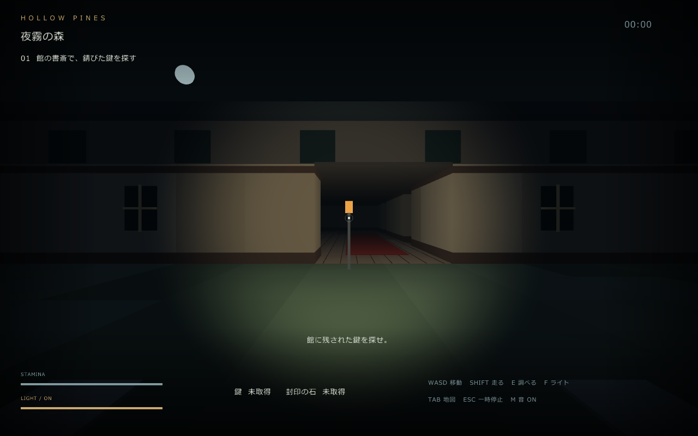
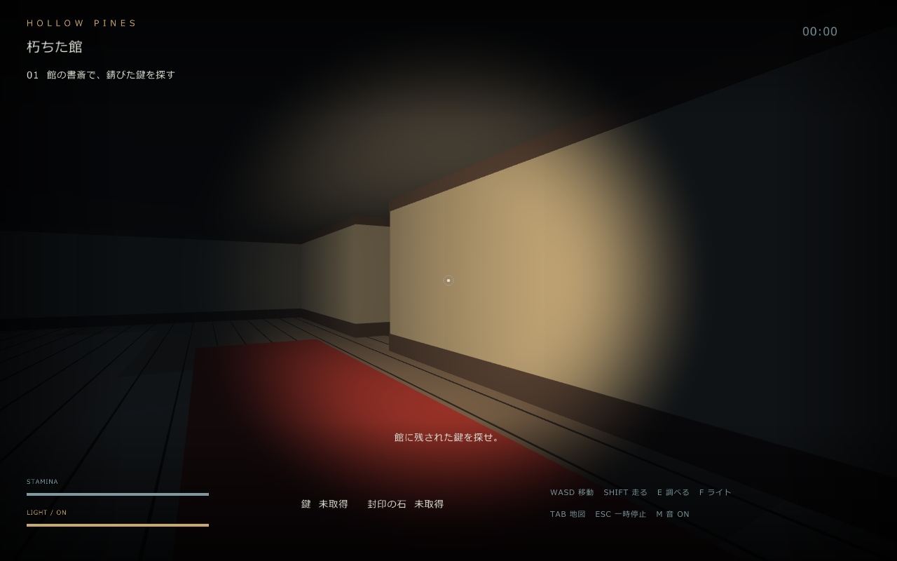

# HOLLOW PINES — 夜霧の館

森で目を覚ました。帰り道は、封じられていた。
館に残された鍵、洞窟の奥に眠る石。そして、闇の中から迫る影。

**HOLLOW PINES — 夜霧の館** は、夜霧の森を探索し、封印された出口からの脱出を目指す一人称視点の3Dホラーゲームです。
懐中電灯で足元を照らし、朽ちた館と洞窟を巡りながら、追いかけてくる幽霊から逃れてください。
光で足止めするか、走って距離を取るか。電池とスタミナを見ながら進みましょう。

## スクリーンショット

夜霧の森にたたずむ館。

鍵を探して、暗い館の中へ。

## はじめかた

Windows x64 向けです。キーボードとマウス、OpenGL 3.3 に対応したGPUが必要です。日本語の表示には、Windowsのメイリオまたは游ゴシックを使用します。

1. 配布ファイル `Horror3D.zip` をフォルダへすべて展開します。
2. 展開先の `HorrorGame.exe` を起動します。
3. タイトル画面で **Enter** を押すとゲームが始まります。

配布版には .NET ランタイムを同梱しています。実行ファイルだけを取り出さず、DLLや `Shaders` フォルダなども一緒に置いてください。

## 操作方法

| キー | 操作 |
| --- | --- |
| W / A / S / D | 前進 / 左移動 / 後退 / 右移動 |
| マウス | 視点を動かす |
| 左Shift（押しながら移動） | ダッシュ。スタミナを消費します |
| E | 近くのアイテムを拾う・鉄格子を開ける・出口を調べる |
| F | 懐中電灯のオン・オフ |
| Tab | 地図を表示・非表示 |
| Space | 魔法のショットガンを発射（入手後） |
| Esc | プレイ中の一時停止・再開 |
| Q | 一時停止中にゲームを終了 |
| Alt + Enter | 全画面表示・ウィンドウ表示の切り替え |
| M | ミュートのオン・オフ |
| R / Enter | ゲームオーバー・通常のクリア画面で最初から再挑戦 |
| A / 「実績を見る」ボタン | タイトル画面でエンディング実績を表示 |
| NEXT ボタンをクリック | 目撃者エンドの次のページへ進む |

ゲームオーバー・通常のクリア画面では **Esc** でタイトルへ戻ります。タイトル画面で **Esc** を押すと終了します。実績画面では「戻る」ボタンまたは **Esc** でタイトルに戻ります。
別のウィンドウへ切り替えると自動で一時停止するので、戻ったら **Esc** で再開してください。

## 脱出までの流れ

1. **館で鍵を探す。** 森の東側にある館へ向かい、南側の玄関から入りましょう。書斎にある鍵へ近づき、**E** で拾います。
2. **洞窟を開く。** 館を出て西側の洞窟へ向かい、鉄格子の前で **E** を押して鍵を使います。
3. **封印の石を手に入れる。** 洞窟の奥を探索し、青緑色に浮かぶ石を **E** で拾います。
4. **森の南端へ戻る。** 祭壇の前で **E** を押し、出口の封印を解けば脱出成功です。

次の目標は画面左上に表示されます。調べられるものに近づくと、画面に **[E]** の案内が出ます。

## 生き延びるためのヒント

- **迷ったら地図を確認。** 上が北、白い点が現在地、金色の点が次の目的地です。地図を開いている間も時間は進みます。休むときは **Esc** で一時停止してください。
- **鍵を拾うと幽霊が動き出します。** 捕まるとゲームオーバーです。接近を知らせる画面のメッセージや鼓動にも注意しましょう。
- **幽霊に光を向けると、動きを遅くできます。** 壁越しには効きません。光を当てながら後退し、ダッシュで距離を取りましょう。
- **電池とスタミナは回復します。** 左下の `STAMINA` がスタミナ、`LIGHT` が電池残量です。スタミナは走っていない間に、電池は消灯中に回復します。電池が切れると自動で消灯するので、回復を待って **F** で点灯してください。
- **石を拾ったあとは帰り道にも注意。** 幽霊の追跡速度が上がります。脱出できる状態では、南端の祭壇と足元が明るい青緑色に明滅し、木々より高い光の柱が出口の目印になります。洞窟出口からも方向を確認できます。

## 隠し要素

隠し武器と結末のヒントを見る（ネタバレ）

封印の石を手に入れると、マップの北東の端に魔法のショットガンが出現します。近づいて **E** で拾い、**Space** で照準の方向へ発射できます。弾数は無制限ですが、次の発射まで少し間隔が必要です。弾は壁や木に遮られます。

幽霊に命中すると一撃で倒せます。倒した幽霊は、そのプレイ中には復活しません。武器を手に入れなくても、石を祭壇へ持ち帰れば脱出できます。

幽霊を倒したら、館へ戻ってみてください。助かった家族が待っています。家族を撃つと、その後の結末が変わります。

家族を全員撃つと、世界が暗赤色に変わり、出口が閉ざされます。洞窟入口の約5m手前まで通路を進むと、家族4人がマップの四隅から幽霊として同時に復活します。通常の幽霊の2.5倍の速度で追跡し、懐中電灯を当てても20%しか減速しません。母・父は通常サイズ、息子・娘は半分のサイズです。それぞれショットガン1発で倒せます。4体すべて倒すと元の世界に戻り、出口が再び開きます。

世界が戻ると、館の東側の外壁の陰に、白い目をした黒い人影の目撃者が現れます。見える位置で7m以内に近づくか、発砲すると逃げ出します。プレイヤーのダッシュより速く、逃走開始から最初の5秒間は弾を回避します。その後、20m以上離れると木や外壁の陰に隠れます。地図の金色の点で居場所を確認できます。

隠れた目撃者には、ライトを消して歩いて近づきましょう。点灯したまま見える位置で14m以内に近づくか、10m以内でダッシュすると気づかれます。消灯して歩けば1.5m以内まで気づかれません。2〜4mほどの距離で1秒以上静止し、遮蔽物のない直撃コースを狙って発砲すると、その弾には反応せず、最初の5秒間の回避も行いません。命中すれば1発で倒せます。外れ弾や壁越しの発砲には反応するので注意してください。

| 脱出時の状態 | エンディング |
| --- | --- |
| 家族を撃っていない（最初の幽霊を倒さずに脱出した場合も含む） | **GOOD END — 夜明け** |
| 家族を1人以上撃ち、生存者がいる | **BAD END — 血塗られた朝**：生き残った家族による復讐 |
| 家族全員と家族の幽霊4体を倒し、目撃者を生かしている | **BAD END — 誰が見ていた？**：一家四人惨殺の罪で逮捕・処刑 |
| 家族全員と家族の幽霊4体、目撃者を倒している | **BAD END — 消えない目撃者** |

「消えない目撃者」では、祭壇で **E** を押すと専用のエンディング画面へ移ります。本文は3ページあり、右下の **NEXT** をクリックして読み進めます。**R / Enter / Esc** では進行しません。最後のページで **NEXT** を押すと白い目と笑みの演出が流れ、自動でタイトルへ戻ります。別のウィンドウへ切り替えている間は演出が止まります。

## プレイについて

現在は、ひとつのマップを探索するプロトタイプです。プレイ途中のセーブ機能はなく、終了後や再挑戦時は最初からのスタートになります。ジャンプ操作はありません。

## エンディング実績

タイトル画面の「実績を見る」ボタン、または **A** で、4種類のエンディングの閲覧状況を確認できます。未閲覧のエンディングは種類やタイトルを伏せて「？？？」と表示されます。実績は再挑戦やゲームの再起動後も残ります。

通常のエンディングはクリア画面が表示された時点で記録します。「消えない目撃者」は最後の演出が完了した時点で記録するため、最後まで見てください。

配布版の実績は、実行ファイルと同じフォルダの `ending-achievements.json` に保存されます。実績を引き継ぐ場合は、このファイルも一緒に保管してください。保存できない場合は実績画面にメッセージが表示されます。

## 開発・検証について

Visual Studioでの起動方法、Debugビルドの保存先、実装や検証コマンドは [src/README.md](src/README.md) を参照してください。
